# LIMINAL 🟨🚪

**LIMINAL** is a first-person exploration and horror game in the Backrooms for Windows, built on its own C++20 engine with a Direct3D 11 renderer. Play it alone or in co-op with up to four players.

<table>
<tr><td width="25%">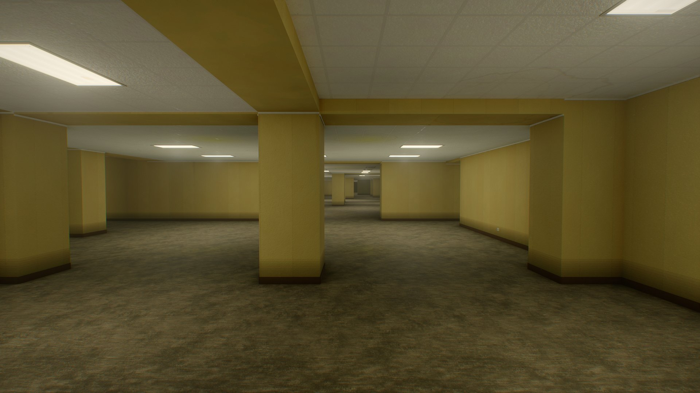<br><sub>Level 0 – yellow rooms around a pillar</sub></td><td width="25%">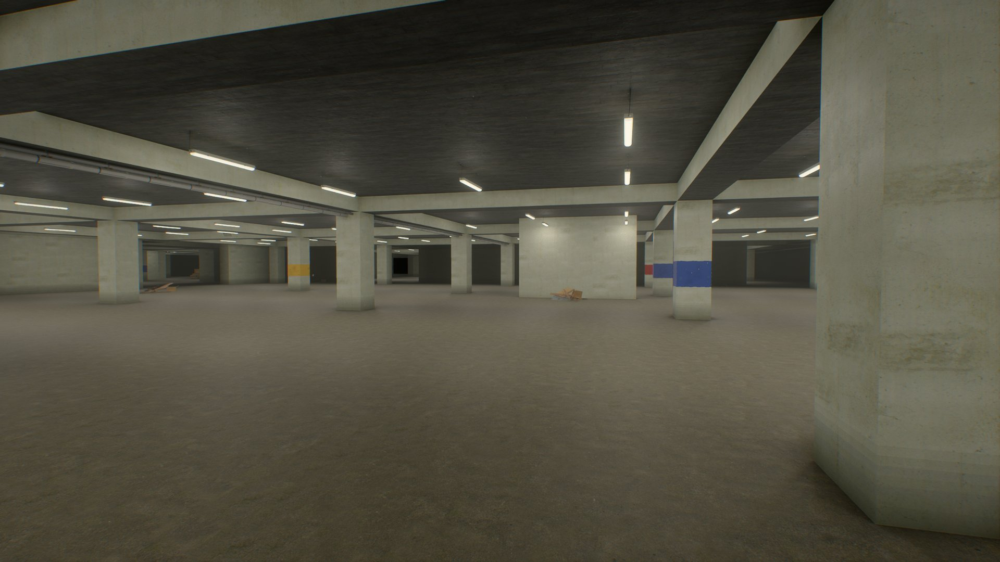<br><sub>Level 1 – concrete hall with fluorescent tubes</sub></td><td width="25%">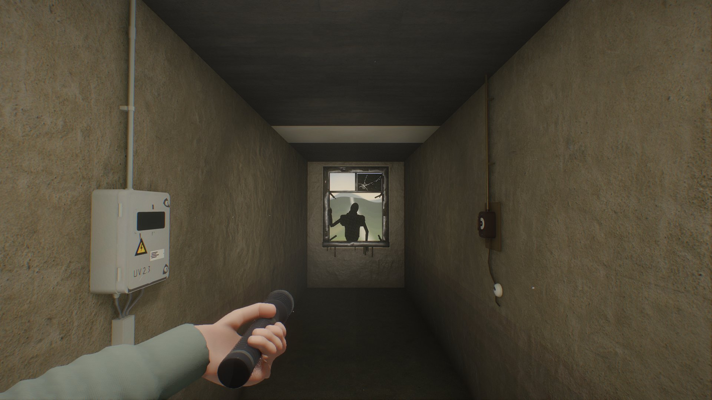<br><sub>Level 2 – a figure at the end of the corridor</sub></td><td width="25%">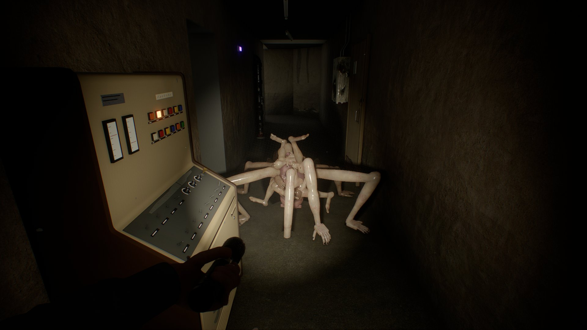<br><sub>Level 2 – the Clump in the flashlight beam</sub></td></tr>
<tr><td width="25%">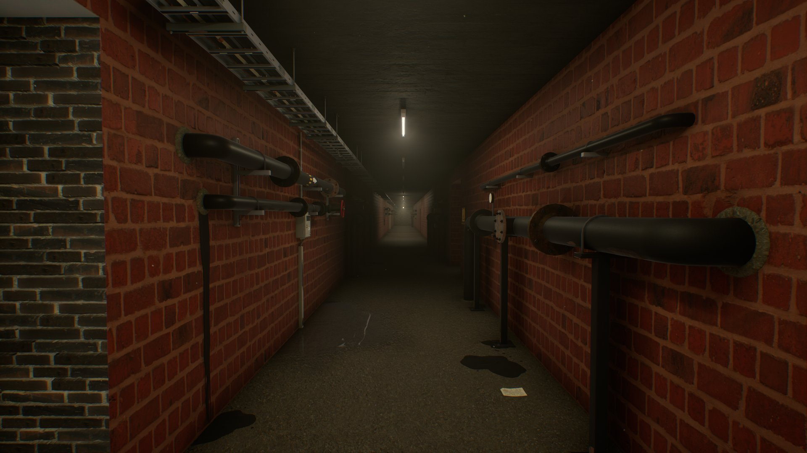<br><sub>Level 3 – brick corridor with pipes and puddles</sub></td><td width="25%">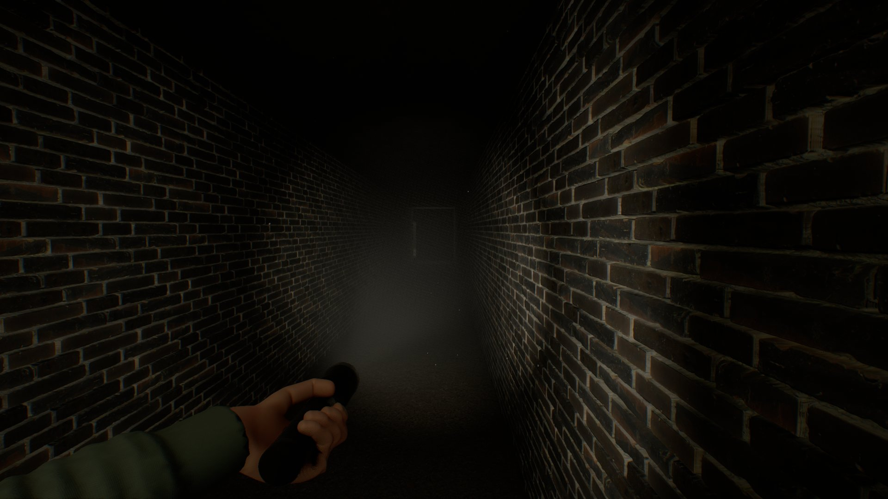<br><sub>Level 3 – only the flashlight</sub></td><td width="25%">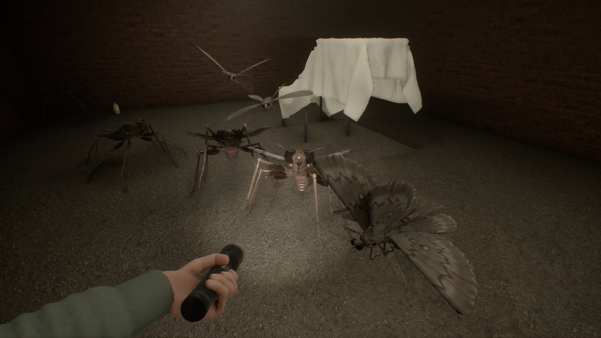<br><sub>Level 3 – deathmoths at arm's length</sub></td><td width="25%">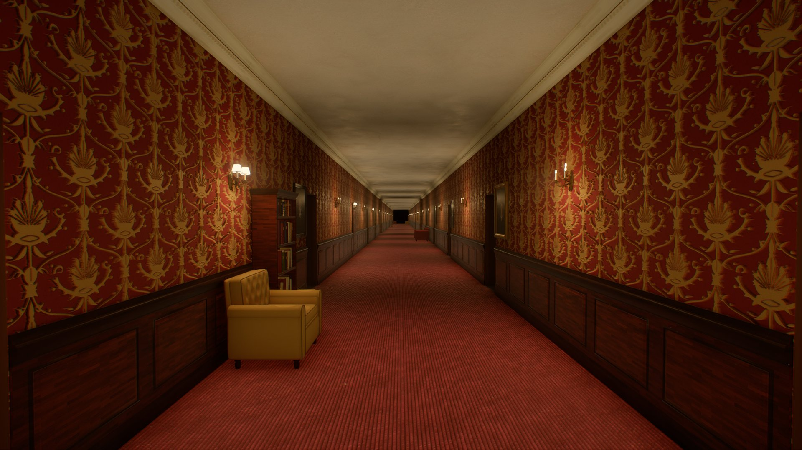<br><sub>Level 5 – the endless hotel corridor</sub></td></tr>
<tr><td width="25%">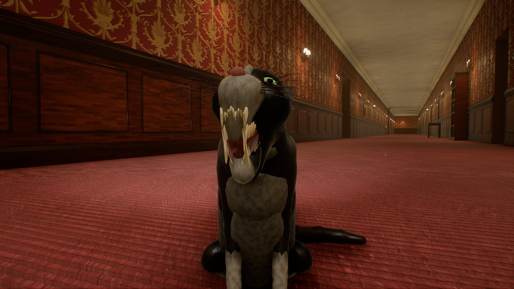<br><sub>Level 5 – Samantha opens her jaw</sub></td><td width="25%">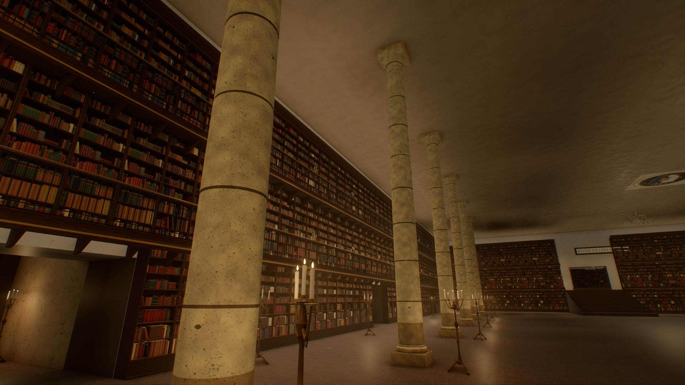<br><sub>Level 5.3 – the library hall</sub></td><td width="25%">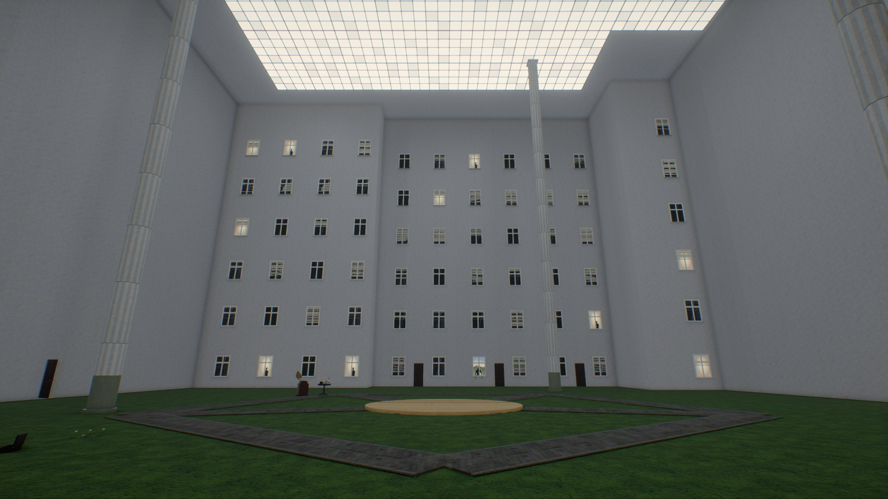<br><sub>Level 188 – the courtyard of windows</sub></td><td width="25%">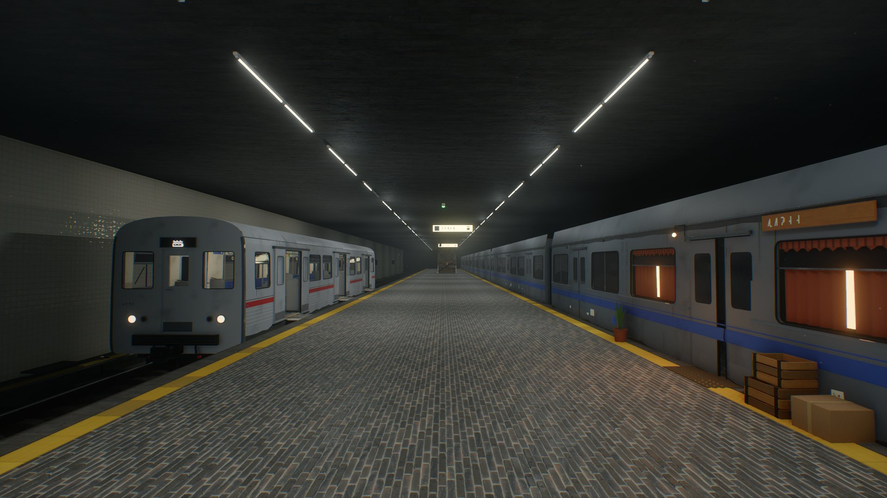<br><sub>Level 903 – a car arrives at the platform</sub></td></tr>
<tr><td width="25%">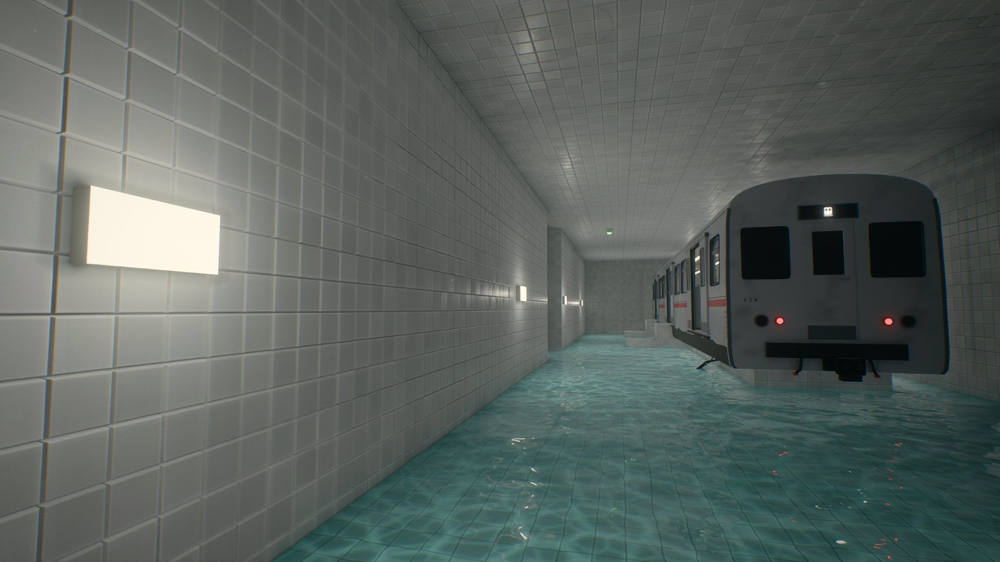<br><sub>Level 37 – a metro car in the flooded tunnel</sub></td><td width="25%">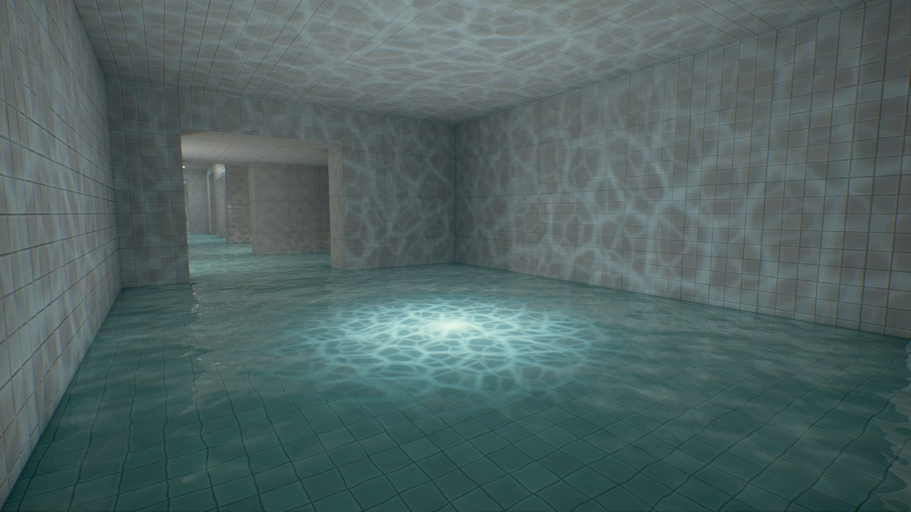<br><sub>Level 37 – light net and reflections</sub></td><td width="25%">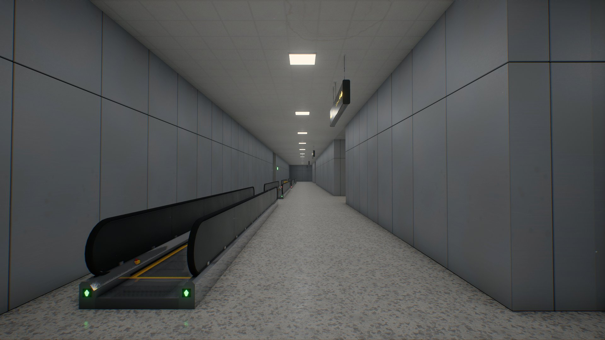<br><sub>Level 36 – the airport concourse</sub></td><td width="25%">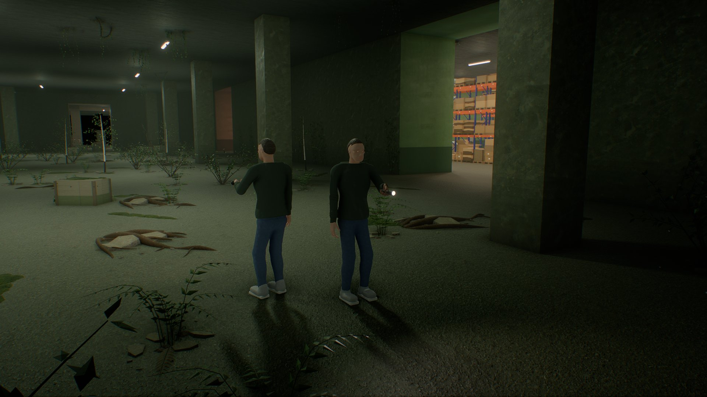<br><sub>Co-op – two players, two game processes</sub></td></tr>
</table>

<sub>Screenshots from V13.3 (1920×1080, in-game, no HUD). The co-op picture shows the guest's view of two real game processes. Older screenshots: <a href="#earlier-screenshots-v12-and-v11">V12 and V11</a>.</sub>

## Features (V13.3, the latest released version)

- **Ten levels** after the [Backrooms Wiki](https://backrooms-wiki.wikidot.com) (Wikidot): Level 0, 1, 2, 3, 5, 5.3, 188, 903, 37 and 36, connected as one journey that ends at gate C33 of the Timeless Airport. Each level was checked in several critique rounds with walkway pictures and measurements.
- **The entities of every level page** (Smilers, Hounds, Deathmoths, the Clump, Facelings, Skin-Stealers, Wretches, Death Rats, Samantha, the Window figures and more), each in its own design and with its own rules. Every encounter is lethal but announced; after death you continue at the last safe place.
- **Co-op for up to four players**: host a game and share a join code through a lobby, or connect directly in the LAN. The connection uses WebRTC (ICE/STUN/TURN) with encrypted traffic (DTLS); a relay helps when no direct path exists.
- **Props rebuilt in Blender** for all ten levels, CC0 material textures from ambientCG, clear water with a light net and reflections in Level 37, puddles and reflective floors.
- **Flashlight in a modelled hand**, notes from other wanderers, an inventory, a map and signs between the levels.
- **All sound is synthesized in code**: room tone, footsteps, music, announcements and entities; no samples.

## System requirements

- Windows 10 or 11 (64-bit)
- Graphics card with Direct3D 11 and an up-to-date driver
- No installation: unzip and run `LIMINAL.exe`

## Download and start

| Version | Download |
|---|---|
| **V13.3 (latest)** | [Release v13.3](https://github.com/AmerAsani/LIMINAL/releases/tag/v13.3) – `LIMINAL_V13.zip` (263 MB) in 30 parts; how to join them and the checksum are in the release |
| V12 | [Release v12](https://github.com/AmerAsani/LIMINAL/releases/tag/v12) – `LIMINAL_V12.zip` (157 MB) in 18 parts |
| V11 | [Release v11](https://github.com/AmerAsani/LIMINAL/releases/tag/v11) – `LIMINAL_V11.zip` |
| V10 … V5 | [`downloads/`](downloads/) (`LIMINAL_V10.zip` … `LIMINAL_V5.zip`) |
| V1–V4 (Python / terminal) | source folders `LIMINAL V1` … `LIMINAL V4` |

Unzip and double-click `LIMINAL.exe` (for V13 and V12, join the parts first as described in the release). The executables are **not code-signed**: Windows SmartScreen may show "Windows protected your PC" – click **More info → Run anyway**. Smart App Control (Windows 11) can block unsigned programs while it is on. The full source is here; you can build it yourself instead.

## Co-op (V13.3)

Up to four players. The game package contains everything: the game, `liminal_net.dll` (loaded only when you host or join), the lobby server `liminal_lobby.exe` and the example `koop.example.json`.

The menus are in German. **In the same network (LAN):** in the main menu choose **Koop**, mode **Hosten**, connection **Direkt (LAN / IP-Adresse)**, then **Spiel hosten**. The others choose mode **Beitreten**, the same connection, enter the host's address (**Adresse des Hosts**) and the join code (**Beitrittscode**) from the host's pause menu (**Mitspieler**), then **Beitreten**. Over the internet this needs a port forward on the host (TCP and UDP 27500).

**Through a lobby (no port forwarding for the players):**

1. Start the lobby on a computer the players can reach (command prompt in the game folder):
   ```
   liminal_lobby.exe --port 27515 --turn-port 3478
   ```
2. Put a `koop.json` next to `LIMINAL.exe` (or in `%LOCALAPPDATA%\LIMINAL\`) with the lobby's address, for example:
   ```json
   { "lobby": "ws://192.168.0.10:27515" }
   ```
3. **Koop**, mode **Hosten**, connection **Über die Lobby (Internet)**, **Spiel hosten**. The **join code** (for example `K7QF-M2XA-9FJT`) is in the pause menu under **Mitspieler**; **Ctrl+C** copies it.
4. The other players: **Koop**, mode **Beitreten**, enter the code (Ctrl+V works), connection **Über die Lobby (Internet)**, **Beitreten**.

| `koop.json` field | Meaning |
|---|---|
| `lobby` | address of the lobby (`ws://…` in a LAN, `wss://…` with a certificate on the internet) |
| `lobby_cert` | optional: PEM file or fingerprint of the lobby's certificate |
| `ice_servers` | optional: further STUN/TURN servers |
| `relay_only` | optional: `true` sends all traffic through the relay, so other players do not see your IP address (more delay) |
| `direct_port` | optional: port for **Direkt** (default 27500, TCP and UDP) |

A `koop.json` next to the game is read first; the one in `%LOCALAPPDATA%\LIMINAL\` overrides single fields. With `ws://` the way to the lobby is not encrypted, but the game traffic itself is (DTLS), and the long code in the pause menu lets a guest check the host. For a public lobby use `wss://`. Details – TLS, costs, privacy, error messages – are in [`MULTIPLAYER_SETUP.md`](https://github.com/AmerAsani/LIMINAL/blob/liminal-v13/LIMINAL%20V13/MULTIPLAYER_SETUP.md) (German). Encryption does not make co-op perfectly safe; the known risks are listed in [`MULTIPLAYER_BEDROHUNGSMODELL.md`](https://github.com/AmerAsani/LIMINAL/blob/liminal-v13/LIMINAL%20V13/MULTIPLAYER_BEDROHUNGSMODELL.md).

**Honest status:** co-op was tested on one computer and in two-process runs, not over real internet NAT. In the final 60-minute test one of two runs dropped a guest after 55 minutes; the cause is still open (B-036 in the bug list).

## Controls

| Key | Action |
|---|---|
| W A S D, mouse | walk, look |
| Shift | sprint (costs stamina) |
| C | sneak (slow, barely audible) |
| Space | jump; swim up in water |
| T | flashlight |
| E | pick up, use |
| Q | throw item (Ctrl+Q: whole stack) |
| Tab, M, Esc | inventory, map, menu |
| H / F1 | all keys |

## Source code

The complete source of every released version is public. V1–V10 are folders on `main`; V11, V12 and V13 each live on their own branch.

| Version | Source | Branch / tag |
|---|---|---|
| V1 | [`LIMINAL V1`](https://github.com/AmerAsani/LIMINAL/tree/main/LIMINAL%20V1) | `main` |
| V2 | [`LIMINAL V2`](https://github.com/AmerAsani/LIMINAL/tree/main/LIMINAL%20V2) | `main` |
| V3 | [`LIMINAL V3`](https://github.com/AmerAsani/LIMINAL/tree/main/LIMINAL%20V3) | `main` |
| V4 | [`LIMINAL V4`](https://github.com/AmerAsani/LIMINAL/tree/main/LIMINAL%20V4) | `main` |
| V5 | [`LIMINAL V5`](https://github.com/AmerAsani/LIMINAL/tree/main/LIMINAL%20V5) | `main` |
| V6 | [`LIMINAL V6`](https://github.com/AmerAsani/LIMINAL/tree/main/LIMINAL%20V6) | `main` |
| V7 | [`LIMINAL V7`](https://github.com/AmerAsani/LIMINAL/tree/main/LIMINAL%20V7) | `main` |
| V8 | [`LIMINAL V8`](https://github.com/AmerAsani/LIMINAL/tree/main/LIMINAL%20V8) | `main` |
| V9 | [`LIMINAL V9`](https://github.com/AmerAsani/LIMINAL/tree/main/LIMINAL%20V9) | `main` |
| V10 | [`LIMINAL V10`](https://github.com/AmerAsani/LIMINAL/tree/main/LIMINAL%20V10) | `main` |
| V11 | [`LIMINAL V11`](https://github.com/AmerAsani/LIMINAL/tree/liminal-v11/LIMINAL%20V11) | branch [`liminal-v11`](https://github.com/AmerAsani/LIMINAL/tree/liminal-v11), tag `v11` |
| V12 | [`LIMINAL V12`](https://github.com/AmerAsani/LIMINAL/tree/liminal-v12/LIMINAL%20V12) | branch [`liminal-v12`](https://github.com/AmerAsani/LIMINAL/tree/liminal-v12), tag `v12` |
| V13 | [`LIMINAL V13`](https://github.com/AmerAsani/LIMINAL/tree/liminal-v13/LIMINAL%20V13) | branch [`liminal-v13`](https://github.com/AmerAsani/LIMINAL/tree/liminal-v13), tag `v13.3` |

Clone only the version you want, for example V13:

```
git clone --branch liminal-v13 --single-branch https://github.com/AmerAsani/LIMINAL.git
```

V13 includes the sources of its network libraries (libdatachannel, libjuice, usrsctp, plog, Mbed TLS, nlohmann/json) unchanged in `LIMINAL V13/third_party`, with their license texts, and the lobby server in `LIMINAL V13/tools/lobby`.

## Build from source

No Visual Studio needed. The build script downloads a portable toolchain (llvm-mingw / Clang, CMake, Ninja) into `.toolchain\` inside the version folder; nothing is installed on your system.

```
cd "LIMINAL V13"
powershell -ExecutionPolicy Bypass -File tools\build.ps1
build\Release\bin\LiminalGame.exe
```

`--level level5` starts directly on a level, `--seed N` uses a fixed seed. For V11, V12 and V13, clone their branch first (see [Source code](#source-code)). The V13 build also produces `liminal_net.dll` and `liminal_lobby.exe` for co-op.

## Versions

| Version | Where | In one sentence |
|---|---|---|
| V1 | `main`, `LIMINAL V1` | Core engine and the first renderer, drawn in the CMD terminal (Python). |
| V2 | `main`, `LIMINAL V2` | Menu, minimap, mouse controls and bug fixes. |
| V3 | `main`, `LIMINAL V3` | Camera system, projections, items, inventory, health, sanity and saving. |
| V4 | `main`, `LIMINAL V4` | Main menu, difficulty levels, multiple saves and fullscreen. |
| V5 | `main`, `LIMINAL V5` | Complete rewrite in C++20 with its own Direct3D 11 PBR renderer, procedural sound and gamepad support. |
| V6 | `main`, `LIMINAL V6` | A bigger, more open world, spatial sound and graphics that adapt to your PC. |
| V7 | `main`, `LIMINAL V7` | Flashlight, emergency exits between levels, the hotel level, notes, hallucinations and a run log. |
| V8 | `main`, `LIMINAL V8` | One connected world instead of separate levels, with elevators and quiet discovery. |
| V9 | `main`, `LIMINAL V9` | A goal: three fuses, one elevator, the way out and an ending. |
| V10 | `main`, `LIMINAL V10` | Entities from the Backrooms wikis (Smiler, Hound, Deathmoths, the Gestalt), each where it belongs. |
| V11 | branch `liminal-v11`, tag `v11` | Ten fixed levels as one journey from Level 0 to Level 37, lethal but announced encounters, water and a sound for every level. |
| V12 | branch `liminal-v12`, tag `v12` | Redesign of the ten levels after the Wikidot wiki: fixed maps, Blender models, CC0 textures and a new interface. |
| V13 | branch `liminal-v13`, tag `v13.3` | The entities of every level page, props rebuilt in Blender, clear water with light and reflections, the hand with the flashlight, and co-op for up to four players. Final report: [`REPORT_V13_3.md`](https://github.com/AmerAsani/LIMINAL/blob/liminal-v13/LIMINAL%20V13/REPORT_V13_3.md) (German). |

The original release notes of V1–V10 are in [`docs/HISTORY.md`](docs/HISTORY.md).

## Earlier screenshots (V12 and V11)

<table>
<tr><td width="33%">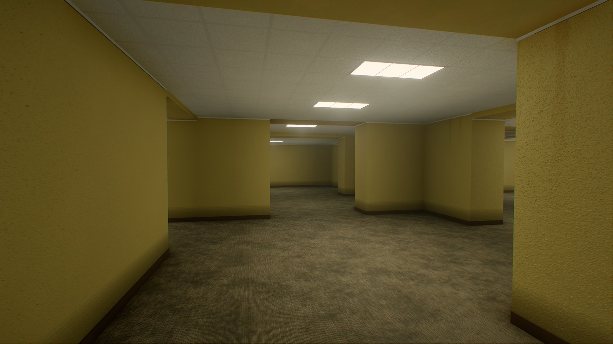<br><sub>Level 0 – yellow rooms and fluorescent panels (V12)</sub></td><td width="33%">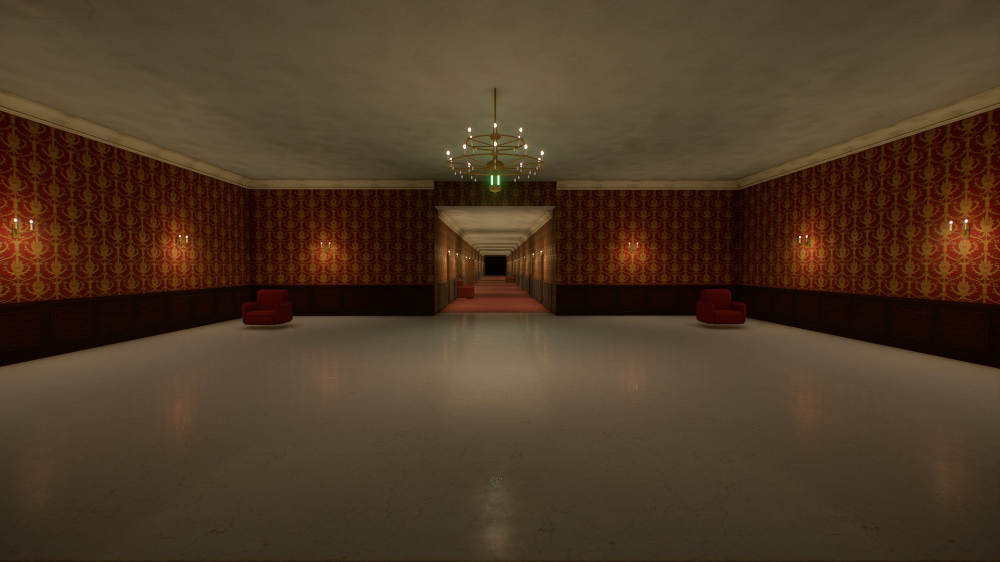<br><sub>Level 5 – the hotel lobby with chandelier (V12)</sub></td><td width="33%">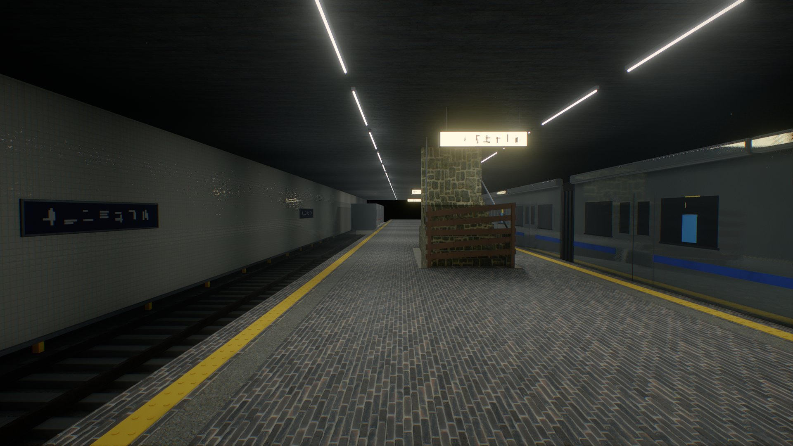<br><sub>Level 903 – the metro platform (V12)</sub></td></tr>
<tr><td width="33%">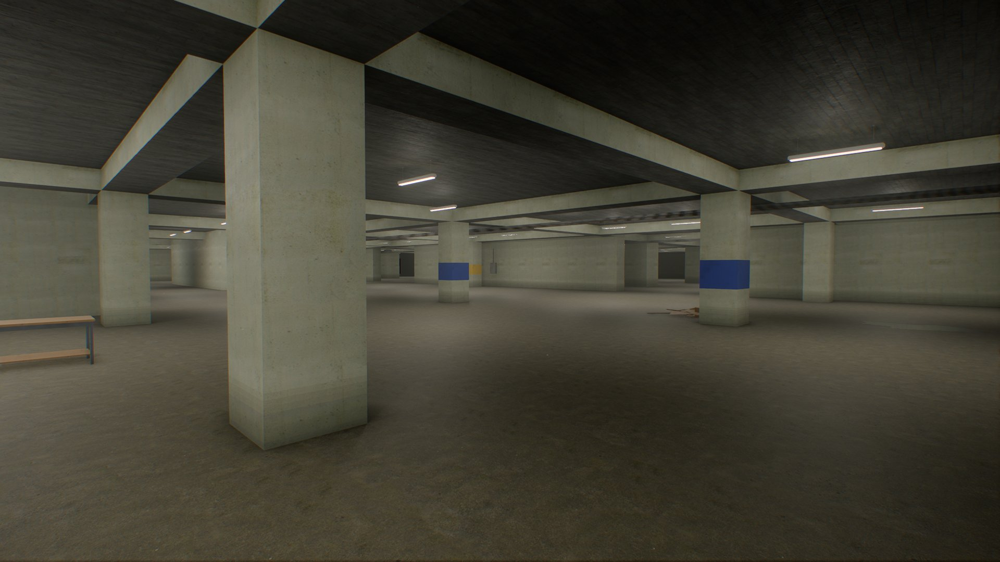<br><sub>Level 1 – concrete halls (V12)</sub></td><td width="33%">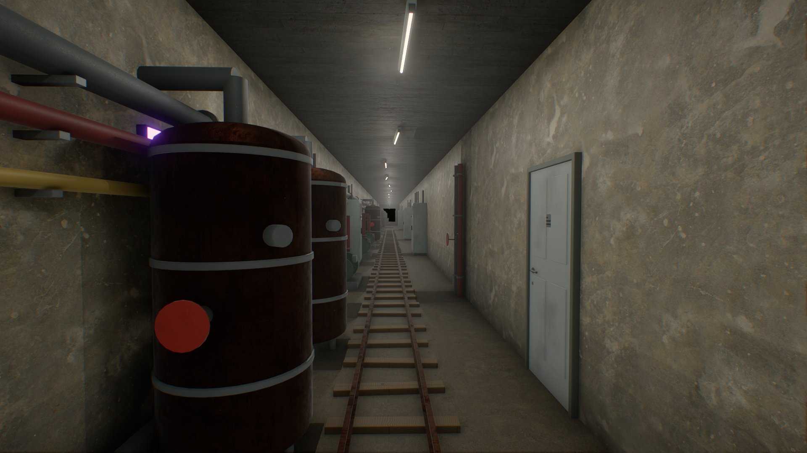<br><sub>Level 2 – tunnels with tanks and rails (V12)</sub></td><td width="33%">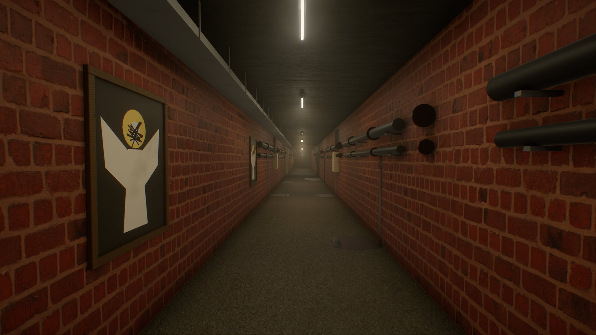<br><sub>Level 3 – brick corridors with the angel sign (V12)</sub></td></tr>
<tr><td width="33%">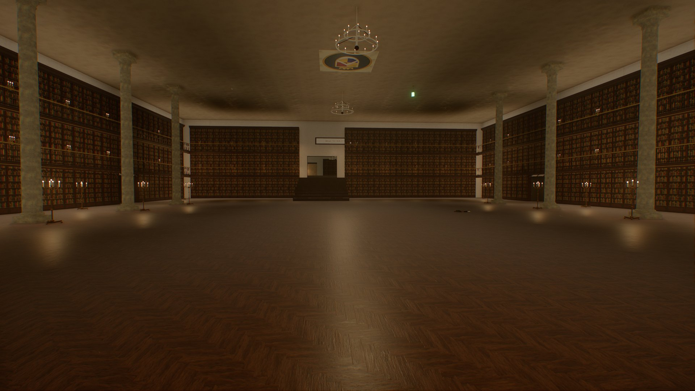<br><sub>Level 5.3 – the library hall (V12)</sub></td><td width="33%">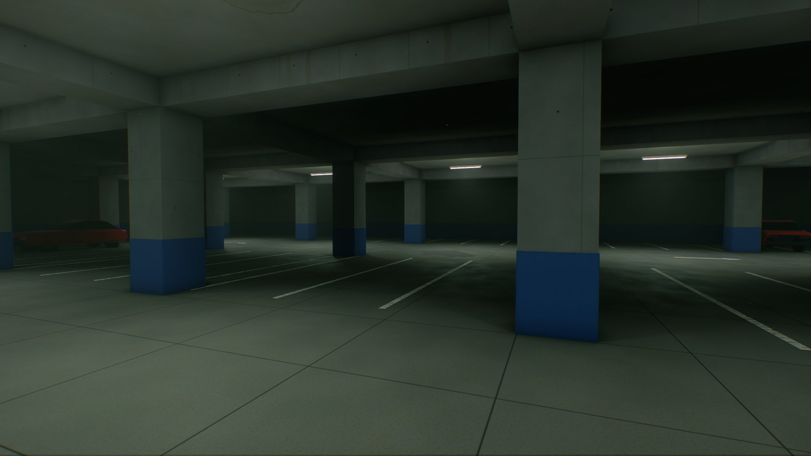<br><sub>Level 1 – the parking deck (V11)</sub></td><td width="33%">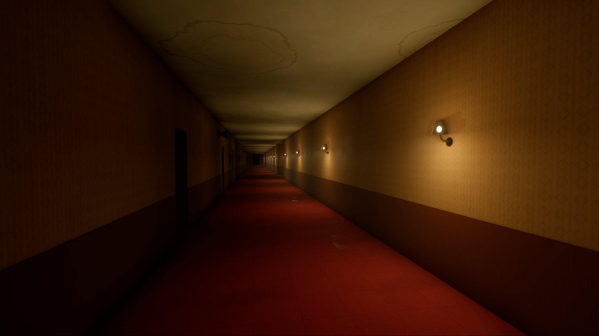<br><sub>Level 5 – a hotel corridor (V11)</sub></td></tr>
</table>

## Licenses and credits

- Overview of all third-party material: [`LICENSES.md`](LICENSES.md); credits for the Backrooms Wiki: [`ATTRIBUTION.md`](ATTRIBUTION.md); license texts of the bundled runtime libraries and the Inter font: [`licenses/`](licenses/).
- The levels and entities are based on the **[Backrooms Wiki](https://backrooms-wiki.wikidot.com) on Wikidot**, whose texts are licensed under [CC BY-SA 3.0](https://creativecommons.org/licenses/by-sa/3.0/). LIMINAL uses them only in its own words and its own designs; no wiki text, image or sound is included. LIMINAL is not an official project of the wiki.
- Material textures (from V12): [ambientCG](https://ambientcg.com), CC0 1.0.
- Co-op network libraries (from V13.3): libdatachannel and libjuice (MPL-2.0), usrsctp (BSD-3-Clause), plog and nlohmann/json (MIT), Mbed TLS (Apache-2.0); sources unchanged in `LIMINAL V13/third_party`, license texts there and in the `licenses` folder of the game package.
- No license has been chosen for LIMINAL itself yet; see [`LICENSES.md`](LICENSES.md).
